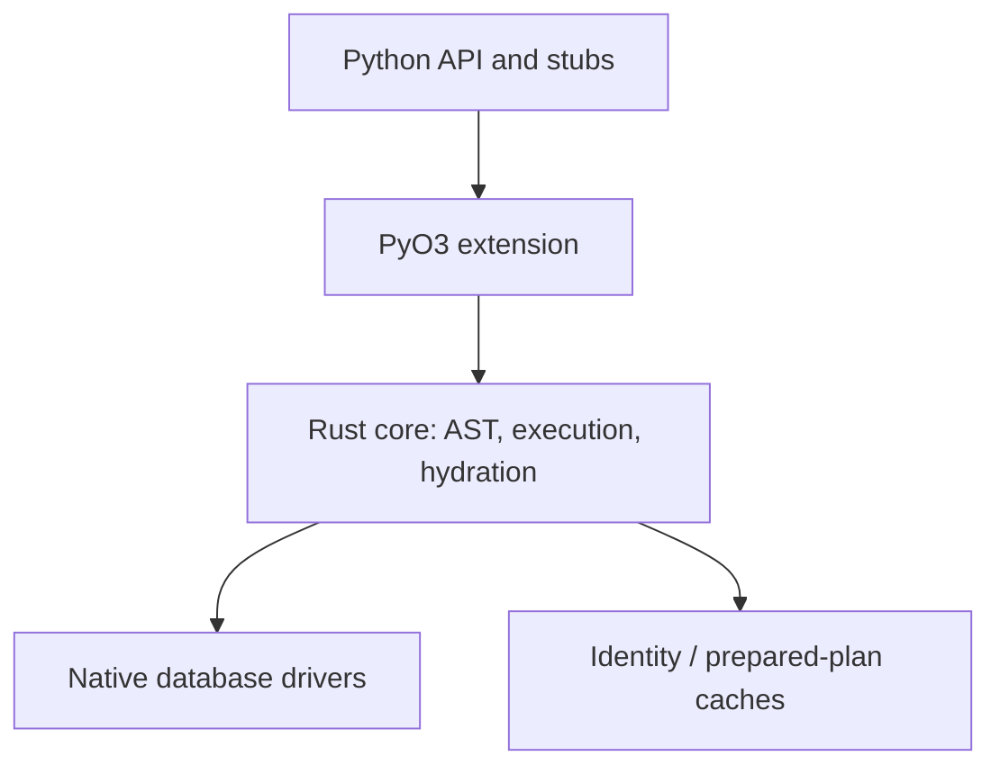
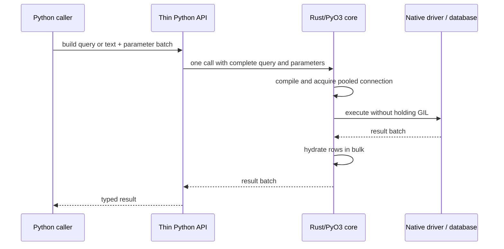
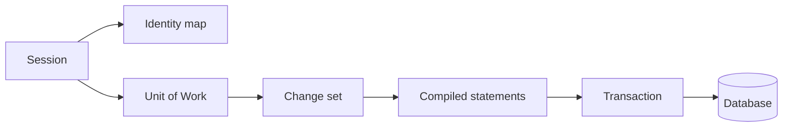
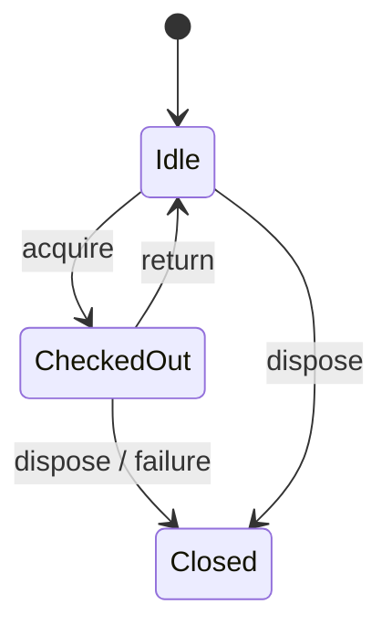

# Architecture

Catalyst is an early-stage, Rust-first Python database toolkit. This document describes the intended architecture; items marked **planned** are not implemented and do not establish parity.

## Crate dependency graph (planned)

The current Rust workspace contains one extension crate; the diagram is the target decomposition, not a claim that these modules exist.

## Query lifecycle (planned)

## FFI and ownership

The Python/Rust boundary is for query and parameter batches, never per row or column. Blocking work must release the GIL using PyO3 `Python::detach`; async work uses Tokio and `pyo3-async-runtimes`. The SQLite implementation isolates synchronous driver calls from Python execution. There is no intentional unsafe code; unsafe remains denied.

## Core expression AST lifecycle

`catalyst.expression` supplies Python metadata holders (`MetaData`, `Table`, `Column`), type markers, immutable expression/statement shells, and compact tagged-tuple serialization. Python is responsible only for ergonomic constructors/operators; one `compile_expression` PyO3 call hands the entire statement tree to Rust. Rust validates/deserializes the tagged form into typed statement/expression enums, compiles SQLite SQL and a deterministic ordered bind sequence, and returns SQL, a named params mapping for inspection, statement kind, positional values, bind column-type tags, bind names, and selected result type tags. This keeps recursive AST work and SQL rendering native while preserving one batch crossing per compile. The engine accepts the statement, compiles it once, and sends SQL, ordered values, bind/result metadata, and known statement kind through one execute crossing; Rust binds values and buffers SELECT results. For executemany the complete sequence of dict/tuple parameter sets crosses the boundary once and is executed on the checked-out connection, with aggregate rowcount; it does not cross per row. Both compile and native execute work run with the GIL detached. Identifier quoting follows SQLite/SQLAlchemy behavior for bare lowercase identifiers, and double-quotes reserved words, mixed/upper-case identifiers, punctuation, and other non-bare identifiers, escaping embedded double-quotes. DDL compilation (`create_table`/`drop_table` statement nodes) is native too: Rust renders SQLAlchemy's exact SQLite `CREATE TABLE`/`DROP TABLE` text, maps declared type markers to SQLite type names, and quotes identifiers. Table existence checks for `checkfirst` run natively on the checked-out connection (`PRAGMA main.table_info`, then `PRAGMA temp.table_info`, matching SQLAlchemy's sqlite `has_table` probes) and are exposed as `NativeConnection.has_table`/`async_has_table`. Current compiler limitations are listed in `docs/parity/core.md`.

Python-side runtime logic is limited to the declarative/user-facing shell and URL/configuration parsing where Python APIs are the compatibility surface. `MetaData.create_all`/`drop_all` and `Table.create`/`drop` delegate to the `catalyst.engine.run_ddl` helper: Python orchestrates the checkfirst/commit loop and the synchronous-versus-asyncengine branching because bind dispatch (sync engine versus awaitable coroutine for `AsyncEngine`) is a Python API surface, while every existence probe and DDL statement remains a native batched call. The helper lives in `catalyst.engine` and is imported lazily from `catalyst.expression` to break the module cycle created by `engine.py` importing expression constructors at module level. Document any additional Python runtime logic with its reason here.

## Session and Unit of Work (planned)

## Connection pool states (planned)

## Current implementation

The native extension defines a SQLAlchemy-style exception hierarchy, a foundation `sqlite_text` helper, and a `NativeEngine`/`NativeConnection`/`NativeResult` set. `NativeEngine` owns a bounded synchronous pool implemented with standard-library mutex/condition-variable primitives. File-backed engines lazily open up to five distinct rusqlite connections; returned checkouts are reused, and a sixth simultaneous checkout raises the mapped `TimeoutError` (immediate exhaustion rather than a timed wait). `:memory:` engines cap the pool at one connection to preserve SQLite's default shared engine database semantics. Blocking checkout, return, disposal, and driver calls run with the GIL released. `NativeResult` buffers rows and exposes `keys`, `rowcount`, and positional `fetchone`/`fetchall`. The `sqlite_text` helper continues using a process-local SQLite connection and returns rows in bulk.

Plan/statement caching model: two layers, both keyed by deterministic content. Python memoizes compiled Core statements in a bounded LRU (512 entries) keyed by the statement's serialized form and compilation dialect; frozen statements make this safe, unhashable bind values bypass the cache, and per-call rebuilds prevent sharing mutable result objects. Rust prepares statements through rusqlite's per-physical-connection statement cache (capacity 128, set when each pool slot opens) — matching ADR 0003's requirement that prepared statements be connection-scoped. Statements reset across transaction boundaries per SQLite semantics; nothing user-visible changes.

Transaction execution model: each physical pool slot owns a shared `Arc<Mutex<TransactionState>>` tracking an open root/implicit transaction and a stack of unique savepoints; logical Python connection wrappers hold no transaction state. Execution uses manual SQL `BEGIN`/`COMMIT`/`ROLLBACK` and `SAVEPOINT` statements on the checked-out rusqlite connection: the first statement autobegins only when the wire is in autocommit (including transactional DDL), while explicit `Connection.begin()` rejects a wire that is already in a transaction. The wire's autocommit flag is authoritative, so a sibling logical checkout of the in-memory singleton joins the open transaction; each logical wrapper also tracks whether it holds its own transaction, and only such holders commit, roll back, or roll back on close, exactly matching SQLAlchemy's per-connection transaction scoping on the shared sqlite :memory: wire (a fresh holder's operations are no-ops). Savepoint state is shared for that physical handle and cleared when the wire transaction ends. This avoids holding rusqlite's lifetime-bound `Transaction` object across separate PyO3 calls. Connection close rolls back an open transaction before returning the pooled handle. Additionally, the pool performs reset-on-return: `PooledConnection::drop` (the single authority on checkout boundaries) executes a plain `ROLLBACK` when `is_autocommit()` reports an open transaction, so a holder dropped without `close()` cannot leak dirty state or strand a mid-transaction slot. Savepoint names are generated (`catalyst_sp_N`) and validated natively before interpolation because `SAVEPOINT` cannot be parameterized. Transaction control, execution, and state transitions run in Rust with the GIL released.

Python-side runtime logic (documented per the FFI rule above): `catalyst.engine` is a user-facing shell — `text()` creates a `TextClause`, sync and async `execute` select mapping versus positional input, normalize an empty parameter sequence for compiled statements to their compiled values (and validate compiled executemany mapping batches), and Python parses URL syntax, query options, and engine options because URL/configuration parsing is the SQLAlchemy-compatible surface. The async shell reuses `CursorResult`: native query rows are fully buffered in a single Rust call, so post-execution fetching does not need asynchronous per-row crossings. `AsyncEngine.connect()` returns an awaitable wrapper that also implements async context management, while `AsyncEngine.begin()` is an async context manager. A tiny Python dialect registry resolves SQLite and raises SQLAlchemy-shaped errors for known-but-uninstalled drivers and unknown plugins. For the native-driver slices, Python recognizes `postgresql://`/`postgres://`/`postgresql+driver://` and `mysql://`/`mysql+driver://` URL prefixes and selects a native engine class; this URL dispatch is Python-side because URL parsing is the SQLAlchemy-facing compatibility surface. The SQLite parser handles memory, relative, and absolute path URL forms. `Engine.connect` asks Rust for a checkout; Python adds context-manager/use-after-close guards and `CursorResult` adapts the buffered native result. Optional echo emits one INFO log entry per statement, not per row. Bind resolution (including SQLite named placeholder lookup and escaped `\\:` handling), typed Core bind conversion, SQLite execution, batch loops, and typed result hydration remain in Rust. SQLAlchemy SQLite DateTime/Date storage formatting is implemented natively without a new Rust dependency; date/time parsing is handled natively and constructs Python values in a single post-query bulk-hydration phase; builtins and datetime modules are imported once per result batch rather than once per cell, while ordinary integer/float coercion uses native extraction where possible. Raw text result columns remain untyped. Decimal/Numeric is not currently supported. Python transaction objects only supply context-manager ergonomics. The async engine supports SQLite plus an initial Tokio-native PostgreSQL single-connection text path. PostgreSQL named binds are scanned in Rust outside SQL strings, quoted identifiers, comments, dollar-quoted bodies, and `::` casts, then converted to positional `$N` parameters. Rust converts supported scalar parameters and buffers primitive bool/integer/float/text/bytea result batches in one FFI return. The selected client/connection and protocol I/O task remain Rust-owned. Each PostgreSQL logical connection tracks implicit/explicit transaction state and executes basic BEGIN/COMMIT/ROLLBACK; it closes the connection on return. TLS uses rustls with ring and the vendored Mozilla WebPKI root store; TLS is mandatory and certificate/hostname verification stays enabled by default. Only explicit URL `sslmode=disable` selects NoTls. Generic driver diagnostics are mapped to redacted Catalyst exception text to avoid echoing credentials, host, or SQL. A bounded async pool lives on the engine: checkouts wait on a Tokio semaphore sized `pool_size + max_overflow` (`-1` means unlimited, like SQLAlchemy's QueuePool) with a `pool_timeout` deadline that raises `TimeoutError` in SQLAlchemy's QueuePool message shape, reuse healthy idle clients, and otherwise open new connections. `NativePgConnection.async_close` rolls back an open transaction before idling the client (reset-on-return) and releases the slot permit; dead clients and returns after dispose are dropped. This slice intentionally lacks ORM support, streaming, executemany, savepoints, cancellation guarantees, pool_pre_ping/recycle, and broad bind/result types. The MySQL slice (ADR 0004) reuses the same shape over `mysql_async`: `NativeMysqlEngine` owns an identical semaphore/idle-stack pool over `Conn` handles (liveness via `is_disconnected`, pool return through `NativeMysqlConnection.async_close` with rollback reset-on-return), and `NativeMysqlConnection` scans named binds in Rust into `?` positional parameters. Execution prefers the prepared binary protocol (`Queryable::exec`/`COM_STMT_EXECUTE`) so integer, float/double, text, date, `datetime(6)`, binary/blob, and decimal result values hydrate typed; statements the server cannot prepare (`ER_UNSUPPORTED_PS`, e.g. `SHOW`) fall back to `query` and decode `Value::Bytes` through column-type tags and the binary-charset marker (63). `has_table` probes `information_schema.TABLES` like SQLAlchemy's MySQL dialect, and server errors map onto the SQLAlchemy hierarchy (1062 → `IntegrityError`) with redacted connect diagnostics. TLS defaults to rustls verification; `sslmode=disable` strips TLS options for local plaintext. MySQL compiled Core statements and executemany are rejected in Python because the dialect compiler does not exist yet. Core compilation accepts a dialect (`sqlite` by default, `postgresql`): the Rust compiler renders PostgreSQL `$N` placeholders, typed/inferred bind casts, inline boolean literals, `||` string concatenation (now also matching SQLAlchemy on SQLite), CAST-based true division, SQLAlchemy's empty-IN forms, `LIMIT ALL OFFSET` pagination, SERIAL single-integer primary keys, and PostgreSQL reserved-word quoting; the Python plan cache is dialect-scoped. The async PostgreSQL connection executes compiled Core select/insert/update/delete and `Compiled` statements directly: `AsyncConnection.execute` compiles expression statements for the `postgresql` dialect, orders user mapping overrides by bind name, and forwards the compiled bind-type metadata so the driver natively coerces compile-processed values (SQLite-formatted datetime/date strings become `TIMESTAMP`/`DATE` parameters, numeric tags coerce, and binary binds require bytes). `MetaData.create_all`/`drop_all` and `Table.create`/`drop` select the PostgreSQL DDL dialect from a PostgreSQL bind, and `has_table` uses a search-path `pg_catalog` probe matching SQLAlchemy 2.x. PostgreSQL executemany still raises `ArgumentError`. The PyO3 module initializes `pyo3-async-runtimes`' Tokio bridge once with a multi-thread runtime (`Builder::new_multi_thread().enable_all()`), preserving sync entry points independently of any Python event loop. `pyo3_async_runtimes::tokio::init` uses a process-wide singleton and panics if another extension has already initialized that bridge; its multi-thread workers persist until process exit, and the crate provides no runtime shutdown hook (clean process exit was verified). Async connection checkout and pool disposal run in `tokio::task::spawn_blocking`; execute and transaction control are also scheduled there, and existing PyO3 sync implementations use `Python::detach` around blocking rusqlite calls. Inputs are converted and results bulk-buffered at the FFI boundary; this async slice does not provide streaming, async sessions, cancellation guarantees, or full concurrency parity. `pyo3-async-runtimes` 0.29.0 matches PyO3 0.29; Tokio 1.45.1 is pinned for the multi-thread runtime.

The native file pool is configured from Python's `pool_size`, `max_overflow`, and `pool_timeout` values (defaults 5, 10, and 30 seconds). Checkout reserves connection capacity under a mutex, waits with a condition variable when at capacity, and opens file connections outside the lock. Returned overflow connections are discarded after reset-on-return; idle pool connections remain bounded by `pool_size`. A zero timeout is immediate. The SQLite driver busy timeout is independent and configured by the SQLite `timeout` option. In-memory SQLite preserves one physical connection shared by every checkout and serializes all operations through its mutex. Transactions opened through any logical checkout are shared: siblings join the open wire transaction, and a commit/rollback through a holder with its own transaction ends it for all holders while fresh holders no-op. This matches SQLAlchemy's default SQLite `:memory:` pool behavior (`SingletonThreadPool`, one shared handle per thread; Catalyst serializes all checkouts through its single handle). File-engine checkouts remain independent physical connections. On file-slot return, `PooledConnection::drop` rolls back any open wire transaction and clears the slot's transaction/savepoint bookkeeping before retaining or discarding the slot; the shared in-memory connection is never reset on an individual holder's return because other holders may still own the open transaction.

The optional Docker integration harness is separate from driver parity: `scripts/integration.sh` starts the pinned PostgreSQL/MySQL services, waits for their Compose health checks, runs only tests marked `integration`, and tears the services down. Ordinary `pytest tests` runs the same stdlib-only socket probes but skips each service probe when its TCP port is unavailable; `scripts/ci.sh` remains Docker-free by default and opts into orchestration only with `CATALYST_INTEGRATION=1`. The probes validate PostgreSQL plaintext startup response framing and a MySQL plaintext protocol-v10 greeting. They do not use Catalyst drivers and prove nothing about SQL behavior, TLS, successful authentication, or SQLAlchemy parity.

## Rust coverage and benchmarks

Run `scripts/coverage.sh` to measure workspace Rust test coverage with `cargo-llvm-cov`; it prints the coverage summary. Install the tool once with `cargo install cargo-llvm-cov --locked`. Coverage is also an opt-in local CI step via `CATALYST_COVERAGE=1 scripts/ci.sh`, keeping the default workflow fast. Run `scripts/bench.sh` for the Rust-only Criterion SQLite/pool benchmarks; optional Criterion filters can be passed after the script name. Set `CATALYST_BENCH=1` to include the benchmark suite in local CI. Benchmarks cover pool checkout/return, buffered SELECT batches, named-bind statement execution, and transaction begin/commit; timings are environment-specific and are not parity claims. Both tools are development-only and add no runtime dependency. Initial local measurements on the current six-test Rust suite report 29.00% line coverage (88.05% in `pool.rs`; PyO3 entry points in `lib.rs` are not exercised by native unit tests). The first Criterion medians were 28.675 ns per pool checkout/return; 4.0646, 5.8892, and 23.527 µs for buffered SELECTs of 10, 100, and 1,000 rows; 330.87 ns for named-bind query execution; and 198.08 ns for transaction begin/commit. These are machine-specific baselines, not performance guarantees.
