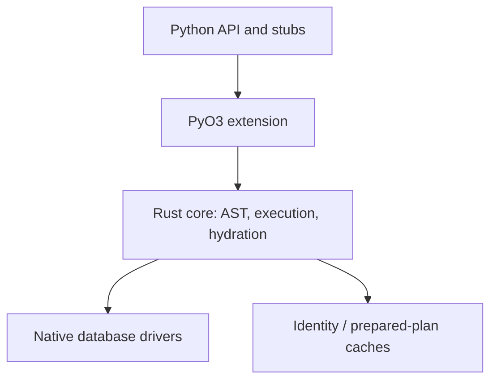
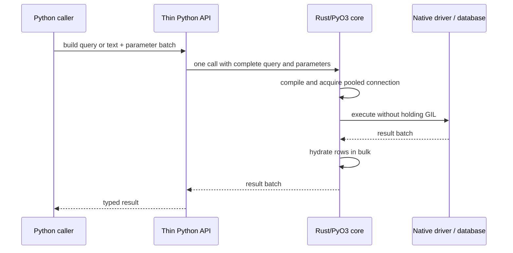
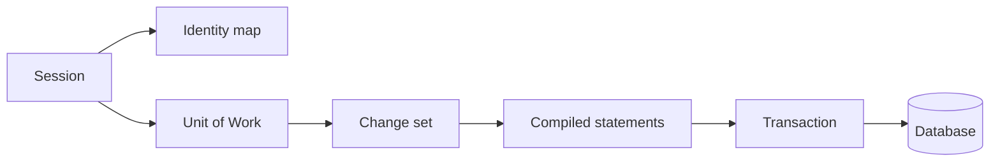
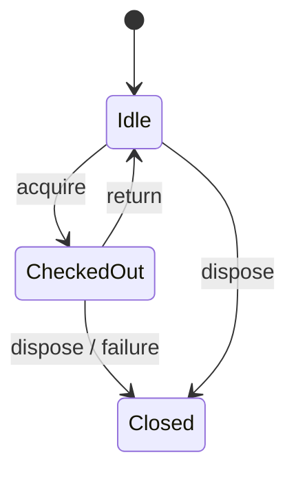

# Architecture

Catalyst is an early-stage, Rust-first Python database toolkit. This document describes the intended architecture; items marked **planned** are not implemented and do not establish parity.

## Crate dependency graph (planned)

The current Rust workspace contains one extension crate; the diagram is the target decomposition, not a claim that these modules exist.

## Query lifecycle (planned)

## FFI and ownership

The Python/Rust boundary is for query and parameter batches, never per row or column. Blocking work must release the GIL using PyO3 `Python::detach`; async work uses Tokio and `pyo3-async-runtimes`. The SQLite implementation is planned to isolate synchronous driver calls from Python execution. There is no intentional unsafe code; unsafe remains denied.

Python-side runtime logic is limited to the declarative/user-facing shell and URL/configuration parsing where Python APIs are the compatibility surface. Document any additional Python runtime logic with its reason here.

## Session and Unit of Work (planned)

## Connection pool states (planned)

## Current implementation

The native extension defines a SQLAlchemy-style exception hierarchy and a foundation `sqlite_text` helper. The helper executes SQL with a positional parameter batch against a process-local SQLite connection and returns rows in bulk. A public engine API, pool, query AST/dialect compiler, and async APIs are not yet implemented. Update this section alongside verified code changes.