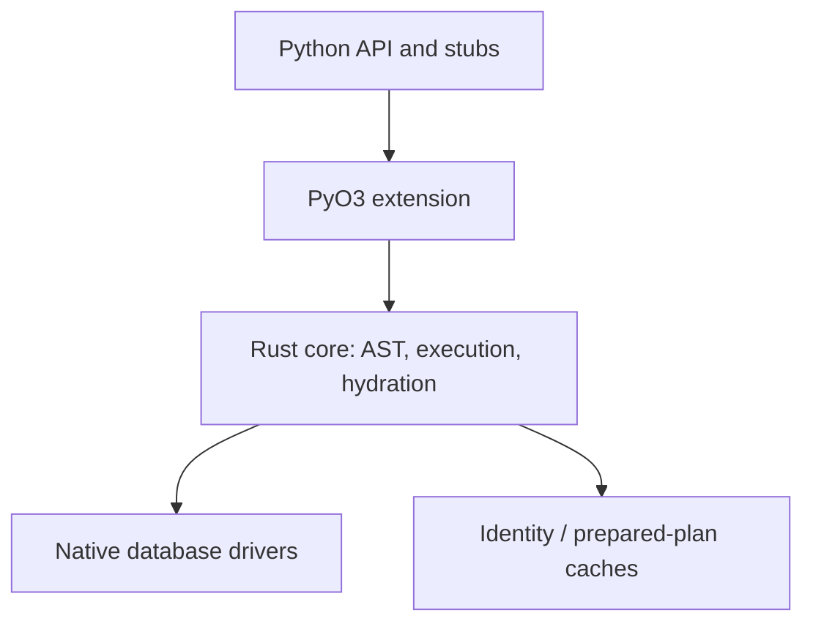
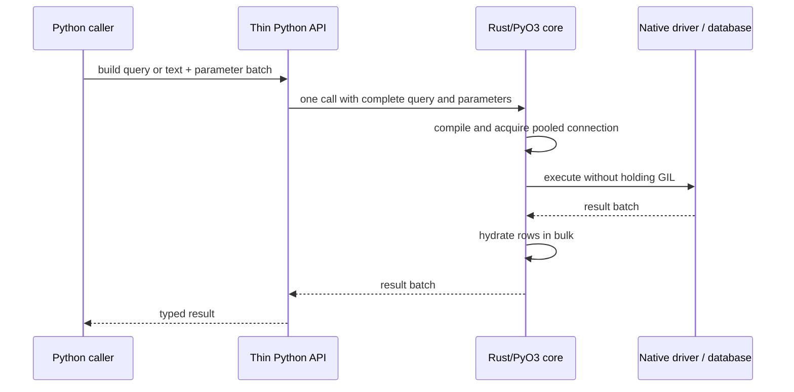
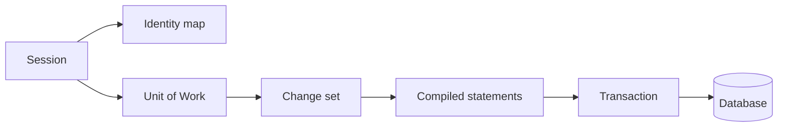
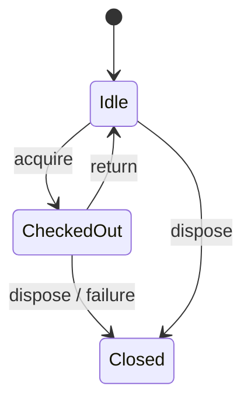

# Architecture

Catalyst is an early-stage, Rust-first Python database toolkit. This document describes the intended architecture; items marked **planned** are not implemented and do not establish parity.

## Crate dependency graph (planned)

The current Rust workspace contains one extension crate; the diagram is the target decomposition, not a claim that these modules exist.

## Query lifecycle (planned)

## FFI and ownership

The Python/Rust boundary is for query and parameter batches, never per row or column. Blocking work must release the GIL using PyO3 `Python::detach`; async work uses Tokio and `pyo3-async-runtimes`. The SQLite implementation isolates synchronous driver calls from Python execution. There is no intentional unsafe code; unsafe remains denied.

## Core expression AST lifecycle

`catalyst.expression` supplies Python metadata holders (`MetaData`, `Table`, `Column`), type markers, immutable expression/statement shells, and compact tagged-tuple serialization. Python is responsible only for ergonomic constructors/operators; one `compile_expression` PyO3 call hands the entire statement tree to Rust. Rust validates/deserializes the tagged form into typed statement/expression enums, compiles dialect SQL (SQLite, PostgreSQL, or MySQL) and a deterministic ordered bind sequence, and returns SQL, a named params mapping for inspection, statement kind, positional values, bind column-type tags, bind names, and selected result type tags. This keeps recursive AST work and SQL rendering native while preserving one batch crossing per compile. The engine accepts the statement, compiles it once, and sends SQL, ordered values, bind/result metadata, and known statement kind through one execute crossing; Rust binds values and buffers SELECT results. For executemany the complete sequence of dict/tuple parameter sets crosses the boundary once and is executed on the checked-out connection, with aggregate rowcount; it does not cross per row. Both compile and native execute work run with the GIL detached; `compile_expression` runs on a dedicated 64 MiB-stack thread (re-attaching the GIL only for Python-side deserialization) so the 2000-deep expression nesting guard fires as `ArgumentError` before the native stack can overflow. SQLAlchemy defers bind processing failures to statement execution, so a literal that fails typed conversion during compile is captured per compile thread and returned on `Compiled.bind_error` while the placeholder keeps the SQL and bind shape intact; `Connection.execute` raises it as a `StatementError` carrying `.orig`, `.statement`, and `.params`. Identifier quoting follows SQLite/SQLAlchemy behavior for bare lowercase identifiers, and double-quotes reserved words, mixed/upper-case identifiers, punctuation, and other non-bare identifiers, escaping embedded double-quotes. DDL compilation (`create_table`/`drop_table` statement nodes) is native too: Rust renders SQLAlchemy's exact SQLite `CREATE TABLE`/`DROP TABLE` text, maps declared type markers to SQLite type names, and quotes identifiers. Table existence checks for `checkfirst` run natively on the checked-out connection (`PRAGMA main.table_info`, then `PRAGMA temp.table_info`, matching SQLAlchemy's sqlite `has_table` probes) and are exposed as `NativeConnection.has_table`/`async_has_table`. Current compiler limitations are listed in `docs/parity/core.md`.

Python-side runtime logic is limited to the declarative/user-facing shell and URL/configuration parsing where Python APIs are the compatibility surface. `MetaData.create_all`/`drop_all` and `Table.create`/`drop` delegate to the `catalyst.engine.run_ddl` helper: Python orchestrates the checkfirst/commit loop and the synchronous-versus-asyncengine branching because bind dispatch (sync engine versus awaitable coroutine for `AsyncEngine`) is a Python API surface, while every existence probe and DDL statement remains a native batched call. The helper lives in `catalyst.engine` and is imported lazily from `catalyst.expression` to break the module cycle created by `engine.py` importing expression constructors at module level. Document any additional Python runtime logic with its reason here.

## Session and Unit of Work (partial)

`catalyst.orm.Session` wraps an `Engine` checkout or shared `Connection` and provides `execute`/`scalars`/`close`. `scalars(select(Entity))` hydrates the buffered rows into mapped instances in a single `NativeResult.hydrate` call — Rust allocates each instance through `cls.__new__` (bypassing `__init__`, matching SQLAlchemy instrumentation) and assigns attribute names per column position, keeping one FFI crossing for the whole batch. Hydrated rows surface as `(entity,)` tuples with `keys() == (Entity,)`; Core `Connection.execute(select(Entity))` still returns raw tuples, matching SQLAlchemy's layer split.

The write path lands the identity map and unit of work **in Rust** (`NativeUow` in `src/session.rs`): a registry of `Py<PyAny>` objects keyed by Python object identity, plus a `(class pointer, pk hash)` → instance identity map and a FIFO sequence ordering for pending objects. `NativeUow` tracks per-object status (`pending`/`persistent`/`deleted`), the dirty-attribute set (set-on-write — `Column`/`Mapped` assignment notifies the owning UOW, and reverting to the old value stays dirty), the expired-attribute set, stored primary keys, and performs hydration reconciliation so `scalars(select(Entity))` returns the already-managed instance for an existing identity instead of allocating a duplicate. Python `Session` orchestrates the SQLAlchemy-facing semantics on top: `add`/`add_all`/`delete` transition object state, `new`/`dirty`/`deleted` expose identity-keyed snapshot sets, `is_modified` reports pending-or-dirty, and `expire`/`expire_all`/`refresh`/`get`/`close`/`begin`/`in_transaction` round out the API. `autoflush` (default `True`) runs `flush()` before `execute`, `scalars`, `get`, and expired-attribute reloads; `expire_on_commit` (default `True`) expires every managed attribute at `commit()` so the next access re-SELECTs — matching SQLAlchemy, **any** expired access emits one `SELECT <all cols>` and clears the whole expired set (full-row refresh, never per-attribute). `Column.__get__` detects expired attributes via the `_catalyst_state` back-pointer the session stamps on managed instances and calls `Session._load_expired`, which re-SELECTs the row by PK and repopulates every expired attribute in one query; a missing row raises `ObjectDeletedError` and expired access on a detached instance raises `DetachedInstanceError`. `UnmappedInstanceError` guards operations on unmapped instances; a flush failure marks the session pending-rollback so subsequent work raises `PendingRollbackError` until `rollback()`, mirroring SQLAlchemy's partial-rollback state.

`NativeUow` also owns detach/expunge primitives so Python keeps no parallel bookkeeping: `detach(obj)` removes one object's state and identity-map entry atomically and returns `(pk, status, dirty, expired)`; `detach_all()` drains every object in one crossing for `expunge_all`/`close`; `persistent_objects(cls)` returns the managed persistent candidate set that ORM DML `synchronize_session` evaluates against; `expire_attrs(obj, names)` expires an exact attribute set (used when ORM UPDATE values are expressions that cannot be computed locally). Python stamps a `_catalyst_detached` marker `(pk, dirty, expired)` on detached instances so loaded values stay readable, `state.key`/`state.modified` semantics survive `expunge` (driving `merge(load=False)` dirty rejection and re-`add` → UPDATE), and expired attributes/relationships raise `DetachedInstanceError`. `identity_get` skips deleted-status entries because SQLAlchemy drops objects from the identity map when their delete is registered.

`Session.merge` is Python orchestration over those primitives: it resolves the source object's identity across managed state, the detached marker, or a transient `__dict__`; looks the identity map up before deciding to `get` (which SELECTs); copies changed column values (instrumented `setattr` under `load=True` so real changes mark dirty, plain `object.__setattr__` under `load=False`); and recurses through relationships carrying the `"merge"` cascade token with an id-keyed recursion cache. `Session.expunge`/`expunge_all` call `detach`/`detach_all` and stamp the marker; `Session.close` rolls back, detaches everything through `detach_all`, releases the owned connection, and — for engine-bound sessions — lazily acquires a fresh checkout on the next operation so the session stays usable (SQLAlchemy semantics; `Session(connection)` instances still cannot re-attach). `Session.get(entity, ident, populate_existing=False)` checks the identity map **before** autoflush (SQLAlchemy `_get_impl` ordering — an identity hit never emits pending writes); `populate_existing=True` skips the map check and re-SELECTs to refresh the already-mapped instance in place.

Bulk methods (`bulk_insert_mappings`, `bulk_update_mappings`, `bulk_save_objects`) bypass the UOW entirely — they compile plain `Insert`/`Update` statements and execute them on the connection with no identity-map involvement, no autoflush, and no PK write-back, matching SQLAlchemy's documented "no session state" contract; `bulk_update_mappings` raises `StaleDataError` when a row's UPDATE matches zero rows. ORM-enabled `session.execute(update(Model)/delete(Model))` retains the mapped entity on the statement (`Update.entity`/`Delete.entity`, populated by the `update()`/`delete()` factories) and honors `execution_options(synchronize_session=...)`: `"auto"` evaluates the WHERE clause in memory when every predicate is a column-vs-literal comparison (and falls back to `"fetch"` otherwise), `"evaluate"` requires it, `"fetch"` appends `RETURNING <pk>` and syncs the matched in-session instances in place (without marking them dirty), and `False`/`"false"` leaves session state untouched; ORM delete marks matching instances deleted — and because `identity_get` skips them, a subsequent `get` SELECTs and returns `None`.

Flush itself crosses the Python/Rust boundary **once per flush**: Python compiles pending INSERTs, dirty-column UPDATEs (only the dirty attributes, keyed by stored PK), and DELETEs into an ordered op list `(sql, positional_params, bind_type_tags, wants_pk)`, `NativeConnection.execute_flush` begins/joins the wire transaction, executes every op natively with typed bind conversion, and returns aligned `last_insert_rowid()` values (captured for **every** op — explicit-PK inserts report their rowid too, so `("__catalyst_rowid__", i)` deferred-FK markers resolve whether the parent key was generated or supplied) which Python writes back to the pending objects' PK attributes before `flush_transition` promotes them to persistent. `commit()` is flush + COMMIT plus the `expire_on_commit` transition; `rollback()` issues ROLLBACK, detaches newly flushed objects (they keep their Python-side values), expires dirty persistent objects, and clears transaction flags. ORM `execute`/`scalars` pass `entity` and the session's `NativeUow` into `CursorResult` so hydrated rows reconcile through the identity map; `get` checks the identity map first (before autoflush), then autoflushes and SELECTs by PK on a miss. Relationship loading (below) consumes the same `NativeUow` reconciliation path. Savepoint semantics under `Session.begin_nested` remain milestone-4 work.

## Relationships and loading

The relationship layer is Python orchestration over the Rust-owned state: declarative descriptors, collections, and cascade policy live in `catalyst.orm` because annotation introspection and descriptor ergonomics are the SQLAlchemy-compatible surface, while DDL/SQL compilation, hydration, and identity-map reconciliation stay native.

- **Deferred mapper configuration.** `Mapped[list["Child"]]` annotations cannot resolve `Child` during class creation, so `_map_declarative_class` records each `relationship()` declaration on the mapper's `pending_relationships` (with a container/target hint parsed from the raw annotation) instead of resolving eagerly. `configure_mappers()` walks the `_MAPPERS` registry — a per-`MetaData` class-name registry (`_REGISTRIES`, weak-keyed) resolves string targets — and configures each pending declaration into a `RelationshipProperty` (target class + mapper, `manytoone`/`onetomany` direction, the FK column pair discovered by matching `ForeignKey.target_table`, inferred `uselist`, cascade set, and the `back_populates` sibling link). Configuration triggers on first descriptor access, on `Session` relationship work, or explicitly; an unresolvable target raises `InvalidRequestError` on access rather than at class definition, matching SQLAlchemy's deferred-configure behavior.
- **Descriptors and instrumented collections.** `Relationship` is the class-body marker/descriptor: class access yields an `InstrumentedAttribute` (exposing `.property` for loader options), instance access returns the stored value or lazily loads via the owning session's `NativeUow` back-pointer. One-to-many values are `InstrumentedList`, a `list[object]` subclass whose mutation methods (`append`/`extend`/`insert`/`remove`/`pop`/`clear`/slice ops/`+=`) emit back-population events that synchronize the sibling attribute and apply the `save-update`/`delete-orphan` cascades; unbound instances behave as plain lists so transient objects can collect children pre-`add`.
- **Cascades and flush-time FK sync.** `session.add` walks `save-update` relationships recursively; `session.delete` applies `delete`/`delete-orphan` (children first) or the default behavior (clear related references so flush nulls the FKs, producing the verified `IntegrityError` on non-nullable columns). Flush topologically orders inserts parents-before-dependents and deletes dependents-before-parents, then syncs relationship references to FK columns; a dependent's FK bound to a pending parent's generated key travels as a deferred `("__catalyst_rowid__", op_index)` marker inside the single `execute_flush` batch, resolved natively from the parent op's `last_insert_rowid()` — so the whole dependency chain still crosses the FFI once.
- **Loader strategies.** Lazy access (`lazy="select"`) emits one child-table SELECT per parent (bind-first, no `IN`); a NULL many-to-one FK short-circuits to `None` with zero SQL, and loaded values are cached on the instance. `joinedload` rewrites the `Select` with a Rust-rendered `LEFT OUTER JOIN` over aliased target columns, then `NativeResult.hydrate_entities` materializes one tuple per SQL row for the entity specs (all-NULL outer-joined slices become `None`); collection joined loads set `CursorResult.requires_unique`, so consumption without `.unique()` raises `InvalidRequestError` matching SQLAlchemy 2.x. `selectinload` runs the parent SELECT plus one batched `IN` follow-up per relationship (FK-first column order, matching SQLAlchemy's emitted SQL). Every loaded row reconciles through `NativeUow.reconcile`, so `p.children[0] is session.get(Child, pk)` holds; `Result.unique()`/`ScalarResult.unique()` deduplicate by instance identity for entity rows and by row equality otherwise (`scalars(select(P).join(C))` intentionally does **not** dedupe).
- **Many-to-many via `secondary`.** `relationship(secondary=)` configures a `manytomany` `RelationshipProperty` carrying the association `Table` plus its `secondary_local`/`secondary_remote` columns — the two FK paths inferred from each association column's `ForeignKey.target_table` (`primaryjoin`/`secondaryjoin` select the association column explicitly for self-referential mappings, where inference raises the native `AmbiguousForeignKeysError`, an `ArgumentError` subclass). There are no object-level FKs: membership lives only in association rows, so committed membership is tracked per attribute as a remote-PK set under `__dict__["_catalyst_m2m_base"]`, populated at load and invalidated on expiry. Loads stay SQLAlchemy-shaped — lazy access emits the implicit comma join (`FROM child, assoc WHERE ? = assoc.local AND child.pk = assoc.remote`, the `implicit_from` join kind), `selectinload` leads with the association table and its grouping FK column (`FROM assoc JOIN child ... IN (...)`), and `joinedload` renders the nested `LEFT OUTER JOIN (assoc AS a_1 JOIN t AS t_1 ON ...) ON ...` (`left_outer_join_nested`). Flush adds an association phase after mapped-object INSERTs and before DELETEs: pending/dirty/deleted objects' m2m attributes are diffed against the baseline (a one-SELECT `_m2m_base_rows` fallback when unobserved) and emit deduplicated `DELETE FROM assoc` before `INSERT INTO assoc`, both riding the single `execute_flush` crossing with deferred `__catalyst_rowid__` binds for not-yet-inserted members; the baseline is refreshed after a successful flush. Collection/scalar mutations mark the attribute dirty on the UOW (`viewonly` relationships load and back-populate but never emit association ops), `delete-orphan` requires `single_parent=True` at configure, and a m2m `backref` installs a peer declaration with the join directions swapped.

## Declarative inheritance

Single-table inheritance (STI) and joined-table inheritance (JTI) are Python orchestration over the same Rust state — mapping-time metadata plus hydration-time resolution — matching SQLAlchemy 2.x semantics verified in `docs/inheritance-ground-truth.md`. Concrete-table inheritance stays unimplemented.

- **Mapper hierarchy.** `Mapper` carries `inherits` (immediate parent), `base_mapper` (hierarchy root), `polymorphic_on`/`polymorphic_on_attr` (the discriminator column and its attribute name), `polymorphic_identity` (no class-name default — omitted stays `None` with the verified `SAWarning`, and INSERTs write NULL), `polymorphic_map` (identity → concrete class, shared by reference across the hierarchy), and `self_and_descendants` (registration-ordered identity subtree). `__mapper_args__` parses `polymorphic_on` (must name a mapped attribute — otherwise `ArgumentError`), `polymorphic_identity`, and an `inherits` key resolving a class or mapper; `_map_declarative_class` routes a subclass without `__tablename__` under a mapped parent into `_map_sti_subclass`, which reuses the parent's `Table` object and appends the subclass's own mapped columns (`Table._append_columns` binds them nullable for sibling rows) while its mapper keeps the parent's attributes plus the new ones (`attr_columns`/`attrs` stay mapper-specific, so `select(Entity)` emits only the queried mapper's columns).
- **Annotation collection.** `_collect_mapped_members` walks the MRO: the concrete class's `Mapped`/`mapped_column`/`relationship()` declarations first, then each unmapped ancestor's (`__abstract__` bases and plain mixins) in MRO order, stopping at a mapped parent for STI subclasses — SQLAlchemy's mixin/abstract column layout (`[id, stamp]` ordering verified against SA 2.1.8).
- **Discriminator plumbing.** `Select._serialize` injects `_polymorphic_criterion` — `<discriminator> IN (identity subtree)` — when the selected entity is an STI subclass, and `Session._execute_orm_dml` appends the same predicate to ORM `update()`/`delete()` (base-class statements stay unfiltered). Flush INSERTs auto-stamp `mapper.polymorphic_identity` when the attribute is unset; a mismatched explicit value warns `SAWarning`. `Session.get` selects only the queried mapper's columns, applies the subtree filter for subclasses, and resolves the row's discriminator through `mapper.polymorphic_map` before identity-map keying.
- **Hydration resolution.** `NativeResult.hydrate`/`hydrate_entities` accept an optional `(discriminator_index, identity_map)` per entity spec (`_hydrate_polymorphic` computes the index inside the spec's own attribute slice): each row's concrete class resolves in Rust — before allocation and before identity-map reconciliation — falling back to the queried class on a missing/NULL identity. `NativeUow.reconcile` keys the identity map by each instance's resolved class pointer, so `session.get(Parent, id)` and `session.get(Sub, id)` converge on one instance. Columns a parent query did not fetch are marked expired (`expire_attrs`) so subclass-only attributes lazily re-SELECT on first access, matching SA's deferred subclass-column load. Relationships targeting an inheritance parent resolve the concrete class the same way through the shared `polymorphic_map`.
- **Joined-table mappers.** `_map_declarative_class` routes a subclass declaring `__tablename__` under a mapped parent into `_map_jti_subclass`, which builds a distinct child `Table` from only the subclass's own declarations — two `CREATE TABLE`s, the child's PK column doubling as `ForeignKey(parent.id)` like SQLAlchemy's JTI convention. Every mapper carries `table_levels` (the distinct hierarchy tables root → leaf, each a `_TableLevel` holding its table, PK column/attribute, local non-PK attributes, and the join column into the previous level) plus a normalized select spec (`select_columns`/`select_attrs`/`select_from`/`select_joins`): child PK columns leaf → root first, then non-PK columns root → leaf, the root table leading the FROM with inner joins down the chain. `select(Sub)` therefore emits `FROM parent JOIN child ON parent.id = child.id` with no discriminator filter — the join's existence implies subclass membership — while `select(Parent)`/`get`/`refresh`/`_load_expired` run through the same entity-select path so `_polymorphic_criterion` still resolves concrete classes and `session.get(Sub, pk)` reads through the join.
- **Entity-select labels.** SQLAlchemy labels duplicate columns differently per context: `id__1` for plain repeated Core columns but `id_1` for whole-entity select lists (JTI joins, eager-load slices). A new serialized node kind `entity_column` marks mapper select-spec items so the Rust compiler applies the single-underscore dedup only there; plain `column` items keep `__N`. `_entity_select_columns` wraps a mapper's `select_columns` for the explicit-column selects built by lazy/selectin/joined relationship loads so those match too.
- **Deferred subclass-table loads.** When a parent query resolves to a JTI subclass, only the root-table attributes populate; `_expire_unloaded` marks the child-table attributes expired, and first access routes `_load_expired` through `_deferred_level` — any expired root attribute means a whole-row reload through the join, otherwise `_load_deferred_level` selects just the expired child-table attributes keyed by the child PK (`SELECT <child cols> WHERE ? = child.id`, the literal-first predicate SQLAlchemy emits). A missing child row — a bulk-deleted parent leaving orphans — raises SA's `KeyError`.
- **Per-table flush.** `_flush_changes` emits one INSERT per table level root → leaf (the child row's PK rides a `__catalyst_rowid__` deferred bind to the parent op's `last_insert_rowid()` inside the same `execute_flush` batch — `persisted` entries now carry `(obj, pk, op_index)`), splits UPDATEs so only levels with dirty columns get one, and orders instance DELETEs leaf → root. Bulk `delete(Parent)` stays a single parent-table DELETE that orphans child rows — a verified SA 2.1.8 surprise — so `_sync_orm_dml` marks matched instances deleted for `session.deleted` bookkeeping while `_synced_deleted` drops them at flush without re-emitting per-row DELETEs. Pool connections now open SQLite with `PRAGMA foreign_keys = OFF` (`open_sqlite` in `src/pool.rs`) matching `sqlite3`/SA defaults — the bundled `libsqlite3-sys` compiles `SQLITE_DEFAULT_FOREIGN_KEYS=1`, which otherwise enforced the child FK and broke the orphan semantics.
- **Parity interop.** `Table`/`Column`/type markers carry the minimal duck-typing surface `sqlalchemy.schema.CreateTable` reads (`_compiler_dispatch`, `dialect_options`, `primary_key`, `foreign_key_constraints`, `_sorted_constraints`, `_prefixes`, `schema`, `description`, `Column.table`), so the parity suites render Catalyst tables through SQLAlchemy's own DDL compiler byte-for-byte. `Select.__clause_element__` coerces a bare `select(SAModel)` to `sqlalchemy.select` (with the `_execute_on_connection` marker) so the same suites can run Catalyst statements against a real SQLAlchemy session.

## Connection pool states (planned)

## Current implementation

The native extension defines a SQLAlchemy-style exception hierarchy, a foundation `sqlite_text` helper, and a `NativeEngine`/`NativeConnection`/`NativeResult` set. `NativeEngine` owns a bounded synchronous pool implemented with standard-library mutex/condition-variable primitives. File-backed engines lazily open up to five distinct rusqlite connections; returned checkouts are reused, and a sixth simultaneous checkout raises the mapped `TimeoutError` (immediate exhaustion rather than a timed wait). `:memory:` engines cap the pool at one connection to preserve SQLite's default shared engine database semantics. Blocking checkout, return, disposal, and driver calls run with the GIL released. `NativeResult` buffers rows and exposes `keys`, `rowcount`, and positional `fetchone`/`fetchall`. The `sqlite_text` helper continues using a process-local SQLite connection and returns rows in bulk.

Plan/statement caching model: two layers, both keyed by deterministic content. Python memoizes compiled Core statements in a bounded LRU (512 entries) keyed by the statement's serialized form and compilation dialect; frozen statements make this safe, unhashable bind values bypass the cache, and per-call rebuilds prevent sharing mutable result objects. Rust prepares statements through rusqlite's per-physical-connection statement cache (capacity 128, set when each pool slot opens) — matching ADR 0003's requirement that prepared statements be connection-scoped. Statements reset across transaction boundaries per SQLite semantics; nothing user-visible changes.

Transaction execution model: each physical pool slot owns a shared `Arc<Mutex<TransactionState>>` tracking an open root/implicit transaction and a stack of unique savepoints; logical Python connection wrappers hold no transaction state. Execution uses manual SQL `BEGIN`/`COMMIT`/`ROLLBACK` and `SAVEPOINT` statements on the checked-out rusqlite connection: the first statement autobegins only when the wire is in autocommit (including transactional DDL), while explicit `Connection.begin()` rejects a wire that is already in a transaction. The wire's autocommit flag is authoritative, so a sibling logical checkout of the in-memory singleton joins the open transaction; each logical wrapper also tracks whether it holds its own transaction, and only such holders commit, roll back, or roll back on close, exactly matching SQLAlchemy's per-connection transaction scoping on the shared sqlite :memory: wire (a fresh holder's operations are no-ops). Savepoint state is shared for that physical handle and cleared when the wire transaction ends. This avoids holding rusqlite's lifetime-bound `Transaction` object across separate PyO3 calls. Connection close rolls back an open transaction before returning the pooled handle. Additionally, the pool performs reset-on-return: `PooledConnection::drop` (the single authority on checkout boundaries) executes a plain `ROLLBACK` when `is_autocommit()` reports an open transaction, so a holder dropped without `close()` cannot leak dirty state or strand a mid-transaction slot. Savepoint names are generated (`catalyst_sp_N`) and validated natively before interpolation because `SAVEPOINT` cannot be parameterized. Transaction control, execution, and state transitions run in Rust with the GIL released. Async savepoints reuse this model: `AsyncConnection.begin_nested()` returns an `AsyncSavepointTransaction` whose `SAVEPOINT` statement is deferred to `start()`/`__aenter__`/`await` (matching SQLAlchemy's `AsyncTransaction`); SQLite savepoint control runs in `spawn_blocking`, while PostgreSQL and MySQL emit `SAVEPOINT`/`RELEASE SAVEPOINT`/`ROLLBACK TO SAVEPOINT` on their native connections with driver-generated `catalyst_sp_N` names validated before interpolation.

Python-side runtime logic (documented per the FFI rule above): `catalyst.engine` is a user-facing shell — `text()` creates a `TextClause`, sync and async `execute` select mapping versus positional input, normalize an empty parameter sequence for compiled statements to their compiled values (and validate compiled executemany mapping batches), and Python parses URL syntax, query options, and engine options because URL/configuration parsing is the SQLAlchemy-compatible surface. The async shell reuses `CursorResult`: native query rows are fully buffered in a single Rust call, so post-execution fetching does not need asynchronous per-row crossings. `AsyncEngine.connect()` returns an awaitable wrapper that also implements async context management, while `AsyncEngine.begin()` is an async context manager. A tiny Python dialect registry resolves SQLite and raises SQLAlchemy-shaped errors for known-but-uninstalled drivers and unknown plugins. For the native-driver slices, Python recognizes `postgresql://`/`postgres://`/`postgresql+driver://` and `mysql://`/`mysql+driver://` URL prefixes and selects a native engine class; this URL dispatch is Python-side because URL parsing is the SQLAlchemy-facing compatibility surface. The SQLite parser handles memory, relative, and absolute path URL forms. `Engine.connect` asks Rust for a checkout; Python adds context-manager/use-after-close guards and `CursorResult` adapts the buffered native result. Optional echo emits one INFO log entry per statement, not per row. Bind resolution (including SQLite named placeholder lookup and escaped `\\:` handling), typed Core bind conversion, SQLite execution, batch loops, and typed result hydration remain in Rust. Parameter-processing failures (`TypeError`/`ValueError` raised while converting binds) are wrapped natively into `StatementError` with SQLAlchemy's message shape; driver-level failures (`ProgrammingError` for unbindable types, `IntegrityError`, and other `DBAPIError` subclasses) keep their concrete class and gain the same `.orig`/`.statement`/`.params` context at the Python shell, while result-decoding errors (for example malformed stored datetimes) propagate unwrapped. SQLAlchemy SQLite DateTime/Date storage formatting is implemented natively without a new Rust dependency; date/time parsing is handled natively and constructs Python values in a single post-query bulk-hydration phase; builtins and datetime modules are imported once per result batch rather than once per cell, while ordinary integer/float coercion uses native extraction where possible. Raw text result columns remain untyped. `Numeric`/`Decimal` support spans all three drivers: on SQLite, Numeric binds convert Decimal to float and results format to the effective return scale (`decimal_return_scale` → declared `scale` → `10`) when `asdecimal=True`, matching SQLAlchemy's float-based SQLite processing; on PostgreSQL a native binary NUMERIC codec encodes/decodes base-10000 wire digits including `NaN`/`Infinity`/`-Infinity` sign codes; on MySQL, `Decimal` binds are sent as text bytes the server coerces, and `text()` statements inline finite Decimal literals because the protocol has no Decimal parameter type (non-finite values render as bare identifiers and fail with server error 1054 → `OperationalError`, matching asyncmy). Numeric overflow maps to the new `DataError` (PostgreSQL SQLSTATE class 22, MySQL errno 1264); MySQL errno 1054 maps to `OperationalError`. Python transaction objects only supply context-manager ergonomics. The async engine supports SQLite plus an initial Tokio-native PostgreSQL single-connection text path. PostgreSQL named binds are scanned in Rust outside SQL strings, quoted identifiers, comments, dollar-quoted bodies, and `::` casts, then converted to positional `$N` parameters. Rust converts supported scalar parameters and buffers primitive bool/integer/float/text/bytea result batches in one FFI return. The selected client/connection and protocol I/O task remain Rust-owned. Each PostgreSQL logical connection tracks implicit/explicit transaction state and executes basic BEGIN/COMMIT/ROLLBACK; it closes the connection on return. TLS uses rustls with ring and the vendored Mozilla WebPKI root store; TLS is mandatory and certificate/hostname verification stays enabled by default. Only explicit URL `sslmode=disable` selects NoTls. Generic driver diagnostics are mapped to redacted Catalyst exception text to avoid echoing credentials, host, or SQL. A bounded async pool lives on the engine: checkouts wait on a Tokio semaphore sized `pool_size + max_overflow` (`-1` means unlimited, like SQLAlchemy's QueuePool) with a `pool_timeout` deadline that raises `TimeoutError` in SQLAlchemy's QueuePool message shape, reuse healthy idle clients, and otherwise open new connections. `NativePgConnection.async_close` rolls back an open transaction before idling the client (reset-on-return) and releases the slot permit; dead clients and returns after dispose are dropped. This slice intentionally lacks ORM support, streaming, cancellation guarantees, pool_pre_ping/recycle, and broad bind/result types. The MySQL slice (ADR 0004) reuses the same shape over `mysql_async`: `NativeMysqlEngine` owns an identical semaphore/idle-stack pool over `Conn` handles (liveness via `is_disconnected`, pool return through `NativeMysqlConnection.async_close` with rollback reset-on-return), and `NativeMysqlConnection` scans named binds in Rust into `?` positional parameters. Execution prefers the prepared binary protocol (`Queryable::exec`/`COM_STMT_EXECUTE`) so integer, float/double, text, date, `datetime(6)`, binary/blob, and decimal result values hydrate typed; statements the server cannot prepare (`ER_UNSUPPORTED_PS`, e.g. `SHOW`) fall back to `query` and decode `Value::Bytes` through column-type tags and the binary-charset marker (63). `has_table` probes `information_schema.TABLES` like SQLAlchemy's MySQL dialect, and server errors map onto the SQLAlchemy hierarchy (1062 → `IntegrityError`) with redacted connect diagnostics. TLS defaults to rustls verification; `sslmode=disable` strips TLS options for local plaintext. Compiled Core statements execute through the `mysql` dialect with the same typed-bind coercion path as PostgreSQL (compile-processed datetime/date strings become `COM_STMT_EXECUTE` date/timestamp parameters). MySQL executemany runs the whole batch inside one Rust async call — every row is converted and coerced in the synchronous PyO3 section (one FFI crossing total), then executed inside a single transaction on the checked-out connection with an aggregated affected rowcount. `INSERT`/`REPLACE ... VALUES (?)` shapes collapse into one multi-row statement like asyncmy's `RE_INSERT_VALUES` rewrite (a mid-batch failure is atomic — no partial rows are visible), while every other statement executes once per parameter group with result sets discarded; a mid-batch failure in that per-group path stops immediately and leaves earlier rows pending in the open transaction for the caller to roll back, matching SQLAlchemy+asyncmy. Core compilation accepts a dialect (`sqlite` by default, `postgresql`, `mysql`): the Rust compiler renders PostgreSQL `$N` placeholders, typed/inferred bind casts, inline boolean literals, `||` string concatenation (now also matching SQLAlchemy on SQLite), CAST-based true division, SQLAlchemy's empty-IN forms, `LIMIT ALL OFFSET` pagination, SERIAL single-integer primary keys, and PostgreSQL reserved-word quoting; for MySQL it renders `?` placeholders for `mysql_async`, `concat()` string concatenation, plain `/` division, `IN (NULL)` empty-set forms, `LIMIT offset, count` pagination (offset-only uses the maximum unsigned BIGINT count), `INTEGER ... AUTO_INCREMENT` single-integer primary keys, explicit NULL binds for empty inserts, and backtick quoting over the MySQL 8.x reserved-word table; the Python plan cache is dialect-scoped. The async PostgreSQL connection executes compiled Core select/insert/update/delete and `Compiled` statements directly: `AsyncConnection.execute` compiles expression statements for the `postgresql` dialect, orders user mapping overrides by bind name, and forwards the compiled bind-type metadata so the driver natively coerces compile-processed values (SQLite-formatted datetime/date strings become `TIMESTAMP`/`DATE` parameters, numeric tags coerce, and binary binds require bytes). `MetaData.create_all`/`drop_all` and `Table.create`/`drop` select the PostgreSQL DDL dialect from a PostgreSQL bind, and `has_table` uses a search-path `pg_catalog` probe matching SQLAlchemy 2.x. PostgreSQL executemany accepts parameter-mapping batches and runs them once per group on the checked-out connection inside a single transaction with an aggregated rowcount (SQLAlchemy+psycopg reports `-1` INSERT rowcounts through its `insertmanyvalues` path where Catalyst returns the true count). The PyO3 module initializes `pyo3-async-runtimes`' Tokio bridge once with a multi-thread runtime (`Builder::new_multi_thread().enable_all()`), preserving sync entry points independently of any Python event loop. `pyo3_async_runtimes::tokio::init` uses a process-wide singleton and panics if another extension has already initialized that bridge; its multi-thread workers persist until process exit, and the crate provides no runtime shutdown hook (clean process exit was verified). Async connection checkout and pool disposal run in `tokio::task::spawn_blocking`; execute and transaction control are also scheduled there, and existing PyO3 sync implementations use `Python::detach` around blocking rusqlite calls. Inputs are converted and results bulk-buffered at the FFI boundary; this async slice does not provide streaming, async sessions, cancellation guarantees, or full concurrency parity. `pyo3-async-runtimes` 0.29.0 matches PyO3 0.29; Tokio 1.45.1 is pinned for the multi-thread runtime.

The native file pool is configured from Python's `pool_size`, `max_overflow`, and `pool_timeout` values (defaults 5, 10, and 30 seconds). Checkout reserves connection capacity under a mutex, waits with a condition variable when at capacity, and opens file connections outside the lock. Returned overflow connections are discarded after reset-on-return; idle pool connections remain bounded by `pool_size`. A zero timeout is immediate. The SQLite driver busy timeout is independent and configured by the SQLite `timeout` option. In-memory SQLite preserves one physical connection shared by every checkout and serializes all operations through its mutex. Transactions opened through any logical checkout are shared: siblings join the open wire transaction, and a commit/rollback through a holder with its own transaction ends it for all holders while fresh holders no-op. This matches SQLAlchemy's default SQLite `:memory:` pool behavior (`SingletonThreadPool`, one shared handle per thread; Catalyst serializes all checkouts through its single handle). File-engine checkouts remain independent physical connections. On file-slot return, `PooledConnection::drop` rolls back any open wire transaction and clears the slot's transaction/savepoint bookkeeping before retaining or discarding the slot; the shared in-memory connection is never reset on an individual holder's return because other holders may still own the open transaction.

`catalyst.orm` holds the declarative mapping layer: `DeclarativeBase.__init_subclass__` builds a Core `Table` from `Mapped[T]` annotations (Python type inference, `Optional`/`X | None` nullability, `mapped_column` overrides) at class-definition time — this is Python-side because annotation introspection and metaclass ergonomics are the SQLAlchemy-compatible surface, while the resulting `Table`/`Column` objects reuse the same Rust compile path as hand-written Core. Mapped classes get `__table__`/`__mapper__`, a kwargs `__init__` with SQLAlchemy's invalid-argument `TypeError`, and `Column` class attributes for expression building; `select(Entity)` marks the immutable `Select` (and its `Compiled`) with the entity so the ORM facade can hydrate, and `insert`/`update`/`delete` unwrap mapped classes to their `Table`. `Mapped`/`MappedColumn` are typed as descriptors under `@dataclass_transform` (via `typing_extensions`, matching SQLAlchemy's own marker), giving subclasses a synthesized keyword-only `__init__` whose parameter types come from `Mapped.__set__` — strict `User(id=1)` typing under mypy/pyright with no plugin.

The optional Docker integration harness is separate from driver parity: `scripts/integration.sh` starts the pinned PostgreSQL/MySQL services, waits for their Compose health checks, runs only tests marked `integration`, and tears the services down. Ordinary `pytest tests` runs the same stdlib-only socket probes but skips each service probe when its TCP port is unavailable; `scripts/ci.sh` remains Docker-free by default and opts into orchestration only with `CATALYST_INTEGRATION=1`. The probes validate PostgreSQL plaintext startup response framing and a MySQL plaintext protocol-v10 greeting. They do not use Catalyst drivers and prove nothing about SQL behavior, TLS, successful authentication, or SQLAlchemy parity.

## Rust coverage and benchmarks

Run `scripts/coverage.sh` to measure workspace Rust test coverage with `cargo-llvm-cov`; it prints the coverage summary. Install the tool once with `cargo install cargo-llvm-cov --locked`. Coverage is also an opt-in local CI step via `CATALYST_COVERAGE=1 scripts/ci.sh`, keeping the default workflow fast. Run `scripts/bench.sh` for the Rust-only Criterion SQLite/pool benchmarks; optional Criterion filters can be passed after the script name. Set `CATALYST_BENCH=1` to include the benchmark suite in local CI. Benchmarks cover pool checkout/return, buffered SELECT batches, named-bind statement execution, and transaction begin/commit; timings are environment-specific and are not parity claims. Both tools are development-only and add no runtime dependency. Initial local measurements on the current six-test Rust suite report 29.00% line coverage (88.05% in `pool.rs`; PyO3 entry points in `lib.rs` are not exercised by native unit tests). The first Criterion medians were 28.675 ns per pool checkout/return; 4.0646, 5.8892, and 23.527 µs for buffered SELECTs of 10, 100, and 1,000 rows; 330.87 ns for named-bind query execution; and 198.08 ns for transaction begin/commit. These are machine-specific baselines, not performance guarantees.
