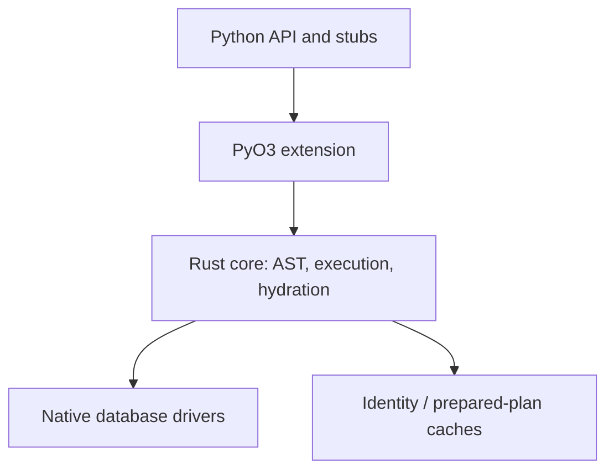
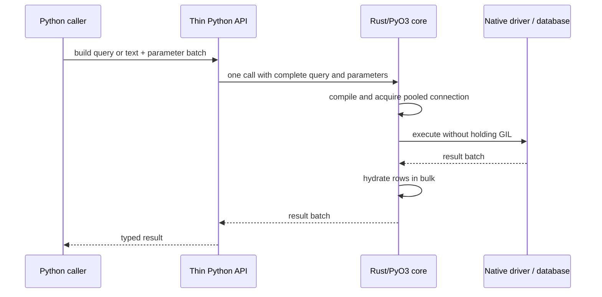
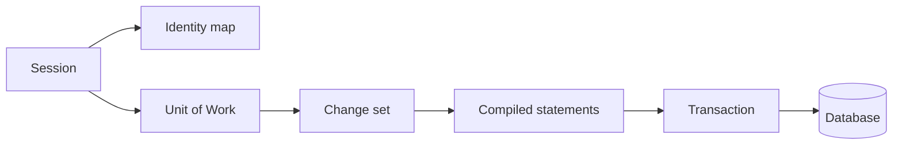
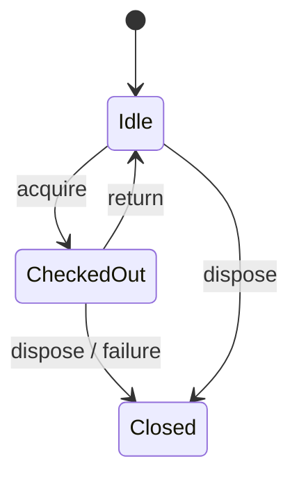

# Architecture

Catalyst is an early-stage, Rust-first Python database toolkit. This document describes the intended architecture; items marked **planned** are not implemented and do not establish parity.

## Crate dependency graph (planned)

The current Rust workspace contains one extension crate; the diagram is the target decomposition, not a claim that these modules exist.

## Query lifecycle (planned)

## FFI and ownership

The Python/Rust boundary is for query and parameter batches, never per row or column. Blocking work must release the GIL using PyO3 `Python::detach`; async work uses Tokio and `pyo3-async-runtimes`. The SQLite implementation is planned to isolate synchronous driver calls from Python execution. There is no intentional unsafe code; unsafe remains denied.

Python-side runtime logic is limited to the declarative/user-facing shell and URL/configuration parsing where Python APIs are the compatibility surface. Document any additional Python runtime logic with its reason here.

## Session and Unit of Work (planned)

## Connection pool states (planned)

## Current implementation

The native extension defines a SQLAlchemy-style exception hierarchy, a foundation `sqlite_text` helper, and a `NativeEngine`/`NativeConnection`/`NativeResult` set. `NativeEngine` owns a bounded synchronous pool implemented with standard-library mutex/condition-variable primitives. File-backed engines lazily open up to five distinct rusqlite connections; returned checkouts are reused, and a sixth simultaneous checkout raises the mapped `TimeoutError` (immediate exhaustion rather than a timed wait). `:memory:` engines cap the pool at one connection to preserve SQLite's default shared engine database semantics. Blocking checkout, return, disposal, and driver calls run with the GIL released. `NativeResult` buffers rows and exposes `keys`, `rowcount`, and positional `fetchone`/`fetchall`. The `sqlite_text` helper continues using a process-local SQLite connection and returns rows in bulk.

Transaction execution model: native connection state tracks an open root/implicit transaction and a stack of unique savepoints. Execution uses manual SQL `BEGIN`/`COMMIT`/`ROLLBACK` and `SAVEPOINT` statements on the checked-out rusqlite connection: the first statement autobegins and leaves its transaction open (including transactional DDL), while explicit `Connection.begin()` rejects an already active transaction. This avoids holding rusqlite's lifetime-bound `Transaction` object across separate PyO3 calls. Connection close rolls back an open transaction before returning the pooled handle. Additionally, the pool performs reset-on-return: `PooledConnection::drop` (the single authority on checkout boundaries) executes a plain `ROLLBACK` when `is_autocommit()` reports an open transaction, so a holder dropped without `close()` cannot leak dirty state or strand a mid-transaction slot. Savepoint names are generated (`catalyst_sp_N`) and validated natively before interpolation because `SAVEPOINT` cannot be parameterized. Transaction control, execution, and state transitions run in Rust with the GIL released.

Python-side runtime logic (documented per the FFI rule above): `catalyst.engine` is a user-facing shell — `text()` creates a `TextClause`, `Connection.execute` selects mapping versus positional input, and Python parses URL syntax, query options, and engine options because URL/configuration parsing is the SQLAlchemy-compatible surface. A tiny Python dialect registry resolves SQLite and raises SQLAlchemy-shaped errors for known-but-uninstalled drivers and unknown plugins. The SQLite parser handles memory, relative, and absolute path URL forms. `Engine.connect` asks Rust for a checkout; Python adds context-manager/use-after-close guards and `CursorResult` adapts the buffered native result. Optional echo emits one INFO log entry per statement, not per row. Bind resolution (including SQLite named placeholder lookup and escaped `\\:` handling), execution, and hydration remain in Rust. Python transaction objects only supply context-manager ergonomics. Async APIs and dialect compilation do not exist yet.

The native file pool is configured from Python's `pool_size`, `max_overflow`, and `pool_timeout` values (defaults 5, 10, and 30 seconds). Checkout reserves connection capacity under a mutex, waits with a condition variable when at capacity, and opens file connections outside the lock. Returned overflow connections are discarded after reset-on-return; idle pool connections remain bounded by `pool_size`. A zero timeout is immediate. The SQLite driver busy timeout is independent and configured by the SQLite `timeout` option. In-memory SQLite preserves the existing one-connection shared-database behavior.

The optional Docker integration harness is separate from driver parity: `scripts/integration.sh` starts the pinned PostgreSQL/MySQL services, waits for their Compose health checks, runs only tests marked `integration`, and tears the services down. Ordinary `pytest tests` runs the same stdlib-only socket probes but skips each service probe when its TCP port is unavailable; `scripts/ci.sh` remains Docker-free by default and opts into orchestration only with `CATALYST_INTEGRATION=1`. The probes validate PostgreSQL plaintext startup response framing and a MySQL plaintext protocol-v10 greeting. They do not use Catalyst drivers and prove nothing about SQL behavior, TLS, successful authentication, or SQLAlchemy parity.

## Rust coverage and benchmarks

Run `scripts/coverage.sh` to measure workspace Rust test coverage with `cargo-llvm-cov`; it prints the coverage summary. Install the tool once with `cargo install cargo-llvm-cov --locked`. Coverage is also an opt-in local CI step via `CATALYST_COVERAGE=1 scripts/ci.sh`, keeping the default workflow fast. Run `scripts/bench.sh` for the Rust-only Criterion SQLite/pool benchmarks; optional Criterion filters can be passed after the script name. Set `CATALYST_BENCH=1` to include the benchmark suite in local CI. Benchmarks cover pool checkout/return, buffered SELECT batches, named-bind statement execution, and transaction begin/commit; timings are environment-specific and are not parity claims. Both tools are development-only and add no runtime dependency. Initial local measurements on the current six-test Rust suite report 29.00% line coverage (88.05% in `pool.rs`; PyO3 entry points in `lib.rs` are not exercised by native unit tests). The first Criterion medians were 28.675 ns per pool checkout/return; 4.0646, 5.8892, and 23.527 µs for buffered SELECTs of 10, 100, and 1,000 rows; 330.87 ns for named-bind query execution; and 198.08 ns for transaction begin/commit. These are machine-specific baselines, not performance guarantees.
